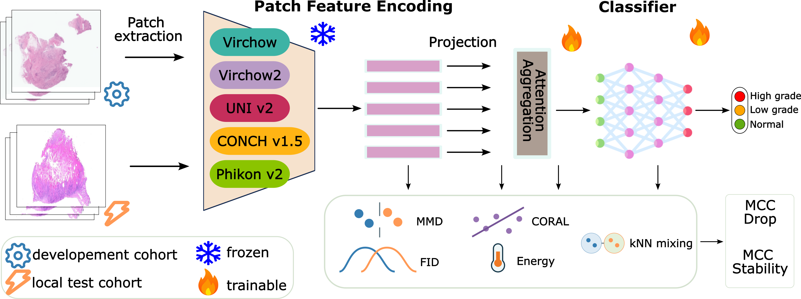

# Local validation of pathology foundation models for colorectal WSI classification

This repository contains the code used to train and validate weakly supervised colorectal whole-slide image (WSI) classifiers from precomputed pathology foundation-model features. The analyses support the COMPAYL 2026 paper **Local Validation and Workflow Integration of Pathology Foundation Models for Colorectal WSI Classification**.


## Overview



The study evaluates how pathology foundation-model features transfer from a public colorectal development cohort to a local hospital validation cohort. Multiple ABMIL training and aggregation settings are compared for each foundation model, and the resulting development-to-local performance drop is analyzed alongside unlabeled representation-shift metrics. Shift is measured both in the original foundation-model embeddings and after successive ABMIL transformations, allowing the code to test whether feature-space differences can help explain local robustness and setting sensitivity.

The main workflow is:

1. Extract patch-level features using Trident and a pathology foundation model.
2. Train slide-level classifiers with attention-based multiple-instance learning (ABMIL).
3. Evaluate development-test and local-validation performance.
4. Quantify representation shift between cohorts in raw feature space and at ABMIL intermediate layers.
5. Summarize model performance, performance drop, and shift-metric associations.

## Repository layout

- `main.py` - trains WSI classifiers from precomputed HDF5 features.
- `predict.py` - runs inference from a saved run/checkpoint.
- `datasets.py` - loads labels and features, including deterministic patch sampling for ABMIL.
- `models.py` - model definitions, including the Trident ABMIL slide-encoder wrapper.
- `train.py` - training, validation, checkpointing, and seeding utilities.
- `metrics.py` - label handling, feature loading, and representation-shift metrics.
- `collect.py` - aggregates trained-run results into report CSV files.
- `compute_fm_shift_repeated.py` - repeated shift analysis in raw foundation-model feature space.
- `compute_abmil_layer_shift_repeated.py` - repeated shift analysis at ABMIL representation layers.
- `results_Statistics.ipynb` - notebook used to generate manuscript figures, tables, and statistical summaries.
- `Paper/` - manuscript source and figure assets.

## Data format

The code expects each cohort root to contain a `labels.csv` file and one or more feature subdirectories produced by Trident. Each WSI feature file should be stored as an HDF5 file named by slide identifier.

Example layout:

```text
<cohort_root>/labels.csv
<cohort_root>/20x_512px_0px_overlap/features_conch_v15/<slide_name>.h5
```

The manuscript experiments used the IMP-CRS development splits and an independent local hospital validation cohort. 

## Installation

Create and activate a Python environment:

```bash
python -m venv .venv
source .venv/bin/activate
python -m pip install --upgrade pip
```

On Windows PowerShell:

```powershell
python -m venv .venv
.\.venv\Scripts\Activate.ps1
python -m pip install --upgrade pip
```

Install Trident from a local clone, then install the dependencies for this repository:

```bash
cd /path/to/trident
pip install -e .
cd /path/to/this/repository
pip install -r requirements.txt
```

For CUDA 12.1 systems, install the PyTorch stack with the matching index URL:

```bash
pip install --upgrade torch torchvision torchaudio --index-url https://download.pytorch.org/whl/cu121
```

## Training

Example ABMIL training command:

```bash
python main.py \
  --mode patch \
  --tile_pooling abmil \
  --feature_subdir 20x_512px_0px_overlap/features_conch_v15 \
  --train_root /path/to/train_cohort \
  --val_root /path/to/validation_cohort \
  --internal_test_root /path/to/development_test_cohort \
  --external_test_root /path/to/local_validation_cohort \
  --seed 1234 \
  --epochs 40 \
  --patience 8 \
  --batch_size 8 \
  --eval_batch_size 16 \
  --num_workers 4 \
  --lr 0.0003 \
  --weight_decay 0.0001 \
  --use_scheduler \
  --num_patches 2000 \
  --hidden_dim 512 \
  --dropout 0.2 \
  --n_heads 4 \
  --head_dim 256 \
  --output_root runs \
  --run_name patch_features_conch_v15_abmil_np2000_h4_hd256_hid512_do02
```

Each run creates a folder under `runs/<run_name>/` containing:

- `config.json`
- `best_model.pt`
- `preds_val.csv`
- `preds_internal_test.csv`
- `preds_external_test.csv`
- `summary.csv`
- `metrics.json`

## Collecting run metrics

After training multiple models, collect run-level metrics with:

```bash
python collect.py --runs_root runs --top_k 10
```

By default, this writes a timestamped report under `runs/reports/`.

## Raw foundation-model shift analysis

This script computes repeated development-to-local shift metrics using one feature vector per slide in the raw foundation-model embedding space.

```bash
python compute_fm_shift_repeated.py \
  --runs-root runs \
  --internal-root /path/to/development_test_cohort \
  --external-root /path/to/local_validation_cohort \
  --device cuda \
  --n-repeats 20 \
  --target-per-domain 80 \
  --sample-external \
  --seed 1234 \
  --knn-k 15 \
  --sigma-sample-size 512 \
  --energy-sample-size 2048 \
  --energy-chunk-size 512 \
  --eps 1e-12
```

The computed metrics include MMD, Fréchet distance, CORAL distance, energy distance, and 1 - kNN domain mixing.

## ABMIL layer-wise shift analysis

This script loads trained ABMIL checkpoints, extracts intermediate representations, and computes the same repeated shift metrics at multiple network stages.

```bash
python compute_abmil_layer_shift_repeated.py \
  --runs-root runs \
  --internal-root /path/to/development_test_cohort \
  --external-root /path/to/local_validation_cohort \
  --device cuda \
  --n-repeats 20 \
  --target-per-domain 80 \
  --sample-external \
  --seed 1234 \
  --knn-k 15 \
  --sigma-sample-size 512 \
  --energy-sample-size 2048 \
  --energy-chunk-size 512 \
  --eps 1e-12
```

By default, the script evaluates:

- `pre_attention_mean` - mean output of the ABMIL pre-attention layers.
- `post_attention` - attention-pooled representation after token rearrangement.
- `penultimate` - representation after post-attention layers and before classification.

The optional top-attention representation can be requested with `--layers topk64_positive_evidence` or included in a comma-separated list.

## Reproducibility

The paper experiments used:

- seed `1234`
- 20 repeated cohort samplings
- 80 development-test and 80 local-validation slides per repetition
- matched sampled cases for shift metrics and repeat-specific MCC-drop calculations
- deterministic ABMIL patch sampling controlled by slide identity, seed, and sampling context


